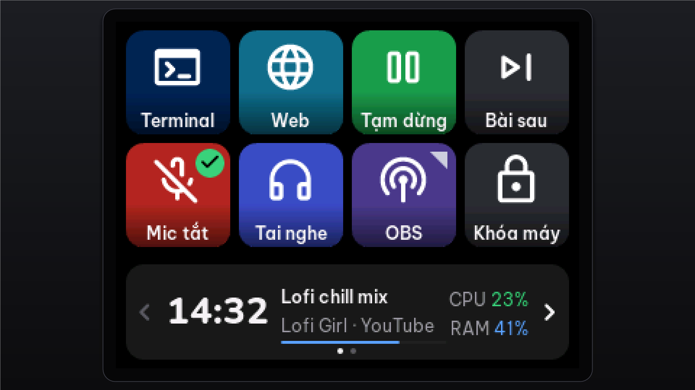
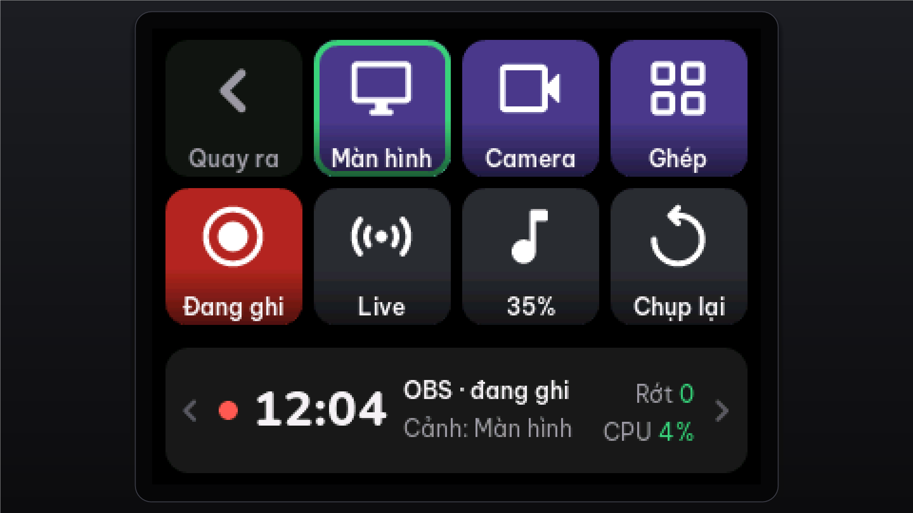
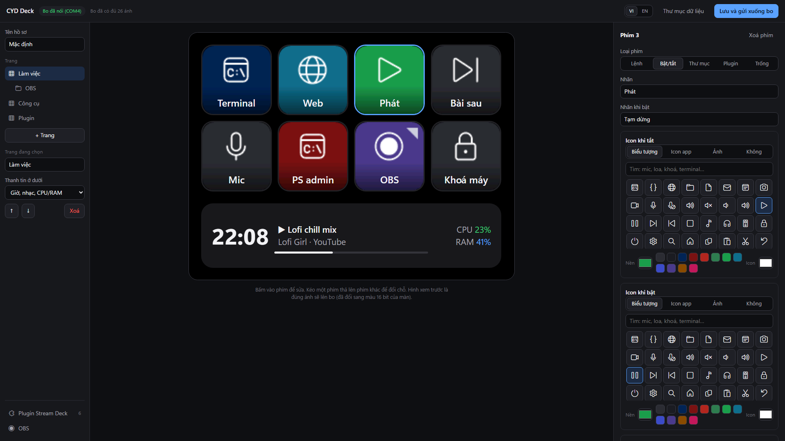
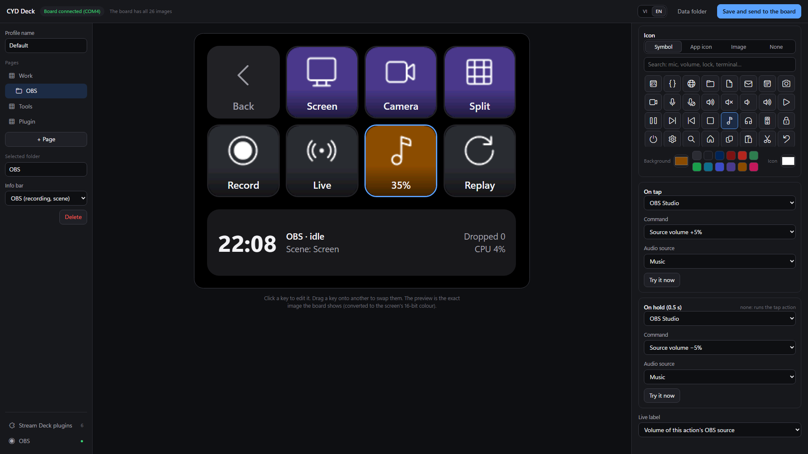
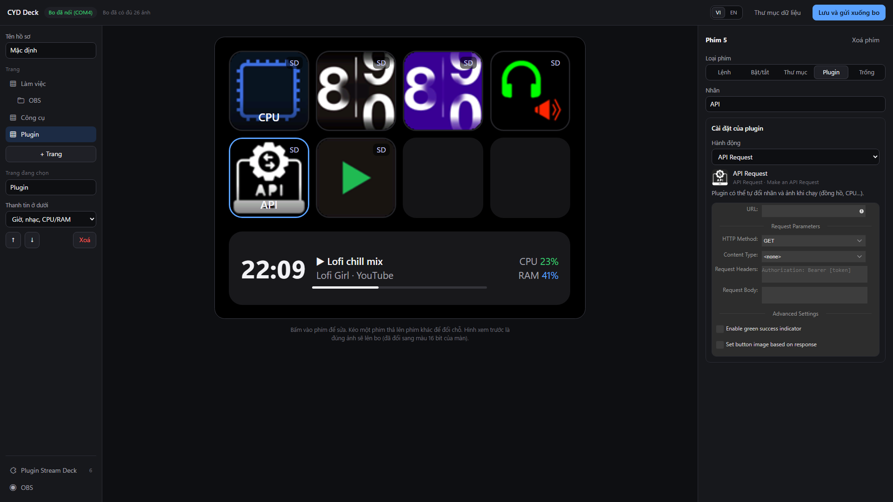
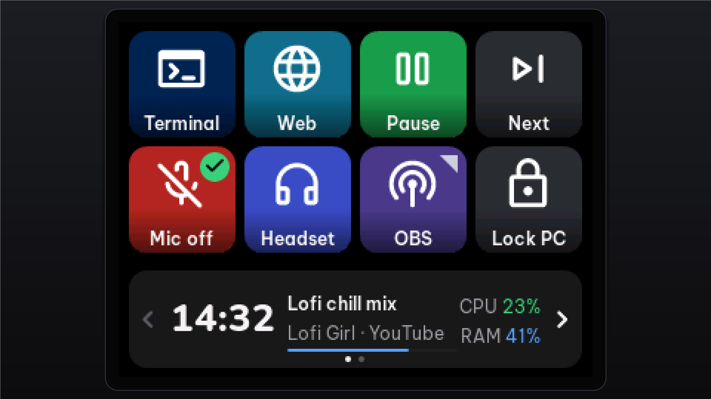
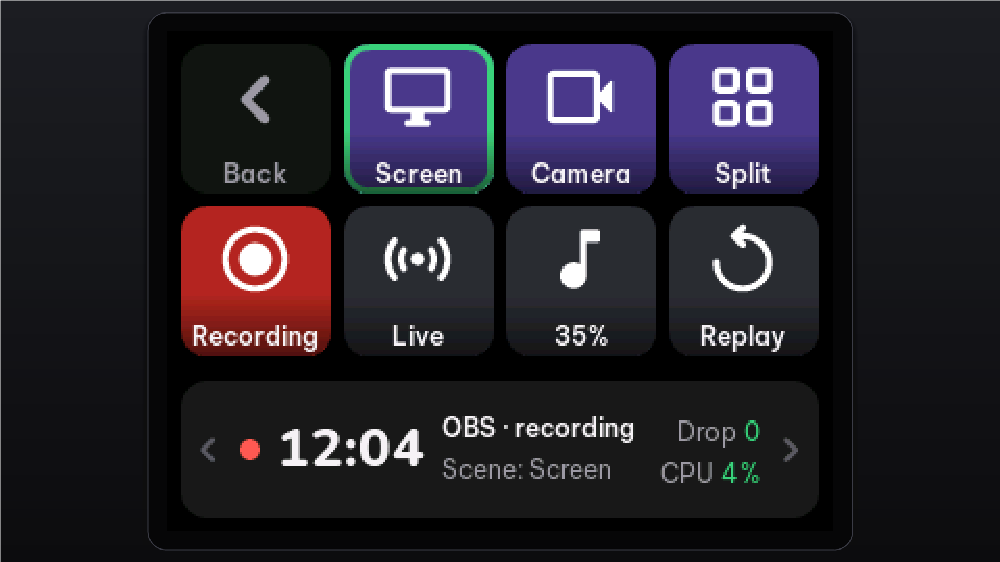
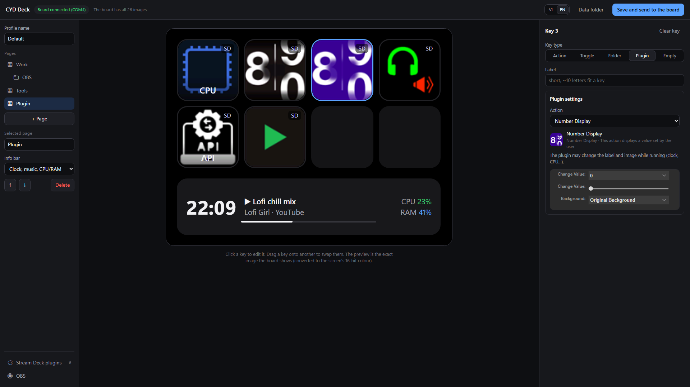

# Stream Deck for ESP32-CYD

**Tiếng Việt** · [English](#english)

Stream Deck gọn nhẹ cho Windows, chạy trên mạch ESP32 "Cheap Yellow Display" (CYD) giá rẻ:
- 8 phím cảm ứng có ảnh màu;
- thanh tin hiện bài nhạc đang phát;
- điều khiển OBS Studio;
- chạy được plugin Stream Deck của Elgato.

Giao diện có tiếng Việt và tiếng Anh. Cấu hình phím bằng một trang web ngay trên máy, nối với mạch chỉ bằng cáp USB.



*Ảnh chụp trực tiếp từ bộ nhớ màn hình của mạch (bộ phím và bài nhạc mẫu), phóng nguyên lần 4 lần.*

## Tiếng Việt

### Mới ở bản 2.0

- **Nhạc đang phát** trên thanh tin:
  - tên bài, "nghệ sĩ · app", vạch tiến độ;
  - phím Phát/Dừng đổi theo trạng thái thật.

  Agent đọc từ điều khiển media của Windows, nên dùng được với Spotify, YouTube trong Edge, Chrome, Firefox, Cốc Cốc,
  Media Player, VLC…
- **OBS Studio** qua obs-websocket (có sẵn trong OBS 28 trở lên):
  - đổi cảnh, phím sáng viền xanh khi cảnh đang phát;
  - ghi hình, tạm dừng ghi, live, virtual cam, lưu replay;
  - tắt tiếng một nguồn, tăng/giảm âm lượng nguồn với nhãn hiện %;
  - thanh tin OBS: đang ghi hay live, thời gian, cảnh, khung rớt, CPU của OBS;
  - một nút dựng sẵn thư mục OBS từ các cảnh đang có.
- **Plugin Stream Deck của Elgato**:
  - cài file `.streamDeckPlugin`;
  - chạy plugin viết bằng C++/C# (`.exe`), Node.js hay HTML/JS;
  - trang cài đặt riêng của plugin (Property Inspector) hiện ngay trong trang cài đặt.

  Xem [Plugin Stream Deck](#plugin-stream-deck).
- **Tiếng Anh** cho mạch, agent và trang cài đặt. Đổi bằng nút VI/EN; lần đầu theo ngôn ngữ của Windows.
- **Nhanh và nhẹ hơn**:
  - cổng USB chạy 921600 baud thay vì 115200, ảnh phím nén RLE;
  - lúc đứng yên mạch chỉ vẽ lại nhãn giờ và CPU/RAM, không vẽ lại phím;
  - agent dùng ít RAM hơn (65–73 MB thay vì 82 MB) và không còn tạo rồi huỷ handle liên tục.

  Số đo ở [Hiệu năng](#hiệu-năng).



*Thư mục OBS (dữ liệu mẫu): cảnh đang phát sáng viền xanh, phím Ghi hình đỏ khi đang ghi, phím nhạc nền hiện âm
lượng nguồn, thanh tin OBS.*

### Có gì

- **8 phím 72×72 px** có ảnh màu và nhãn. Bố cục giống Stream Deck Neo: lưới 4×2 cộng thanh tin ở dưới (giờ, nhạc,
  CPU, RAM). Lật trang bằng hai mép thanh tin hoặc vuốt ngang.
- **Thư mục**: phím có góc tam giác mở một bộ 8 phím khác, phím ‹ để quay ra.
- **Phím bật/tắt** theo trạng thái thật: tắt mic, tắt tiếng loa, phát/dừng nhạc, các phím OBS. Phím âm lượng hiện số %
  ngay trên nhãn.
- **Lệnh**:
  - chạy chương trình, kèm tham số, thư mục làm việc, quyền admin;
  - mở web, file, thư mục hay `ms-settings:`;
  - phím tắt (`Ctrl+Shift+Esc`, `Win+Shift+S`…), gõ một đoạn chữ;
  - nhạc (phát/dừng, bài sau), âm lượng, mic, khoá máy;
  - OBS và hành động của plugin.

  Mỗi phím có thêm một lệnh khi giữ 0,5 giây.
- **Quyền admin không hỏi UAC mỗi lần**: lúc lưu, Windows hỏi UAC **một** lần để đăng ký lệnh vào Task Scheduler; sau
  đó bấm phím là mở được PowerShell hay CMD quyền admin ngay.
- **Hiệu ứng mượt (53–62 khung/giây)**:
  - gợn sóng lan từ chỗ ngón tay chạm, phím lún rồi nảy như lò xo;
  - viền trắng chờ PC, xanh khi xong, cam khi lỗi;
  - lật trang trượt bằng cuộn phần cứng của màn ILI9341.
- **Ảnh và bộ phím lưu trong flash của mạch**, rút cáp vẫn còn. PC chỉ gửi những ảnh mạch chưa có. Ảnh đổi liên tục của
  plugin (đồng hồ, biểu đồ…) đi vào 8 ô ảnh trong RAM, không ghi flash.
- **Chỉ cần cáp USB**: không Wi-Fi, không mở cổng tường lửa, không cài thêm runtime. Agent trên PC dịch bằng `csc.exe`
  có sẵn trong Windows.



*Trang cài đặt, mở từ icon ở khay hệ thống. Lưới phím xem trước đúng màu sẽ lên mạch; kéo thả để đổi chỗ phím; nút
VI/EN đổi ngôn ngữ cho cả trang, agent và mạch.*

### Cần gì

| | |
|---|---|
| Bo | ESP32-2432S028R ("Cheap Yellow Display", 2,8", 320×240, ILI9341, cảm ứng điện trở XPT2046). Đã thử với màn IPS mã `81 81 B3` (firmware tự đảo màu). Bản 2 cổng USB dùng màn ST7789: env `cyd2usb`, chưa thử. |
| Máy tính | Windows 10/11 có .NET Framework 4 (có sẵn). Nên dùng Windows 11: icon trong trang cài đặt lấy từ font Segoe Fluent Icons. Edge để mở cửa sổ cài đặt và chạy plugin HTML. |
| Nạp firmware | [PlatformIO](https://platformio.org/) (bản dòng lệnh hoặc extension VS Code) |
| Tuỳ chọn | [OBS Studio](https://obsproject.com/) 28 trở lên; [Node.js](https://nodejs.org/) cho plugin Node.js |

### Cài đặt

1. **Nạp firmware** (thư mục `firmware`):
   ```powershell
   cd firmware
   .\cyd.cmd all -NoMonitor
   ```
   Lệnh này build, nạp, rồi đọc mã chip màn để kiểm tra đúng loại. Cũng có thể dùng `pio run -t upload`.
   Chưa nối máy tính thì mạch hiện bộ phím mẫu và báo "Đang chờ máy tính…".
2. **Dịch và chạy agent** (thư mục `pc-agent`):
   - nhấp đúp `build.cmd`, ra file `bin\CydAgent.exe`;
   - chạy `bin\CydAgent.exe`: agent không có cửa sổ, chỉ có icon nhỏ ở khay hệ thống;
   - muốn agent tự chạy mỗi lần đăng nhập Windows: chạy `tu-chay.ps1`.
3. **Cài đặt phím**: nhấp đúp icon agent ở khay, hoặc chuột phải → *Cài đặt Deck…*. Sửa phím, bấm **Lưu và gửi xuống
   mạch**.

Agent tự tìm mạch theo chip USB-serial (CH340, CP210x, ESP32-S3), mở cổng mà không khởi động lại mạch. Dữ liệu nằm trong
`%APPDATA%\CydDeck\`:
- `deck.json`: bộ phím;
- `images\`: ảnh tải lên;
- `plugins\`: plugin đã cài;
- `obs.json`: cài đặt OBS, mật khẩu mã hoá bằng DPAPI theo tài khoản Windows.

### OBS Studio

1. Trong OBS: **Tools → WebSocket Server Settings**, bật **Enable WebSocket server**.
2. Trong trang cài đặt, mục **OBS** ở góc trái dưới: bấm **Lấy mật khẩu từ OBS trên máy này**. Agent đọc cổng và mật
   khẩu từ file cấu hình của OBS, không hiện mật khẩu lên trang. OBS chạy trên máy khác thì gõ địa chỉ, cổng, mật
   khẩu.
3. Bấm **Tạo thư mục OBS từ cảnh hiện có**: trang đang chọn có thêm phím thư mục OBS, gồm:
   - tối đa 3 cảnh;
   - Ghi hình, Live;
   - tắt tiếng mic;
   - nhạc nền: chạm để tăng 5 %, giữ để giảm.

   Bấm **Lưu**.

Hoặc tự đặt phím: loại lệnh **OBS Studio**, chọn việc (đổi cảnh, ghi hình…) và cảnh hay nguồn âm thanh. Agent chỉ nối
OBS khi bộ phím có phím OBS hay trang có thanh tin OBS, và tự nối lại khi OBS mở lại.



### Plugin Stream Deck

Agent đóng vai app Stream Deck của Elgato theo SDK của họ (WebSocket JSON). Plugin thấy mạch như một Stream Deck Neo
(4×2 phím). Cài plugin:
1. Tải file `.streamDeckPlugin`, thường ở trang GitHub Releases của plugin.
2. Trong trang cài đặt, mục **Plugin Stream Deck** ở góc trái dưới, bấm **Cài plugin…** và chọn file. Cũng chọn được
   `manifest.json` trong một thư mục `.sdPlugin`.
3. Đặt một phím loại **Plugin**, chọn hành động. Trang cài đặt riêng của plugin hiện ngay bên dưới.



Đã thử với các plugin mã nguồn mở sau (ngày 18/11/2026):

| Plugin | Loại | Kết quả trên mạch |
|---|---|---|
| [CPU](https://github.com/elgatosf/streamdeck-cpu) 1.2 (Elgato) | `.exe` (C++) | Nhãn % CPU đổi mỗi giây |
| [Counter](https://github.com/elgatosf/streamdeck-counter) 1.4 (Elgato) | HTML/JS | Chạm là tăng số, số đếm được lưu |
| [Number Display](https://github.com/elgatosf/streamdeck-numberdisplay) 1.4 (Elgato) | HTML/JS | Chạm là tăng số; trang cài đặt riêng hiện đủ |
| [Audio Switcher](https://github.com/fredemmott/StreamDeck-AudioSwitcher) 3.2.1 | `.exe` (C++) | Trang cài đặt liệt kê loa thật và lưu lựa chọn; phím nhận chạm, đổi trạng thái |
| [API Request](https://github.com/mjbnz/streamdeck-api-request) 0.2 | HTML/JS | Trang cài đặt hiện đủ; chưa có URL thì phím báo ⚠ |
| [Essentials for Spotify](https://github.com/ntanis-dev/essentials-for-spotify) 1.2 | Node.js (SDK 3) | Chạy, nhận chạm, trang cài đặt hiện; cần tài khoản Spotify để điều khiển nhạc |

Hỗ trợ:
- plugin `.exe` (C++, C#), Node.js (`node` trên máy), HTML/JS (chạy trong một Edge ẩn);
- sự kiện keyDown/keyUp, willAppear/willDisappear, didReceiveSettings, didReceiveGlobalSettings,
  propertyInspectorDidAppear/Disappear, sendToPlugin/sendToPropertyInspector, deviceDidConnect,
  titleParametersDidChange;
- lệnh setTitle, setImage (PNG, JPEG, SVG, đường dẫn file), setState, showOk, showAlert, setSettings/getSettings,
  setGlobalSettings/getGlobalSettings, openUrl, logMessage.

Chưa hỗ trợ:
- núm xoay và màn cảm ứng của Stream Deck + (`setFeedback`…);
- multi-action, `switchToProfile`;
- plugin trả phí hay khoá với Elgato Marketplace.

Plugin chỉ chạy khi có phím dùng nó, tắt theo agent, chết thì tự chạy lại (tối đa 5 lần trong 10 phút). Log của từng
plugin xem trong mục Plugin hay ở `pc-agent\logs\plugin-<uuid>.log`.

**An toàn**: cài plugin là chạy mã của người khác trên máy bạn, với quyền của bạn. Chỉ cài từ nguồn tin cậy. Repo này
không kèm plugin nào; ảnh của plugin trong ảnh chụp là của tác giả plugin.

### Quyền admin và an toàn

- Trang cài đặt chỉ nghe ở `127.0.0.1`. Mọi lệnh gửi tới nó cần một mã ngẫu nhiên tạo mỗi lần agent khởi động, nên
  trang web lạ trong trình duyệt không sửa được bộ phím.
- Cổng WebSocket cho plugin cũng chỉ nghe ở `127.0.0.1` và từ chối kết nối từ trang web lạ (header `Origin`). Mỗi
  plugin nhận một mã riêng lúc chạy.
- Phím "Chạy bằng quyền admin" được đăng ký thành tác vụ trong Task Scheduler (thư mục `\CydDeck\`). Tác vụ chạy bằng
  tài khoản của bạn ở quyền cao nhất, chỉ bạn, SYSTEM và Administrators chạy được.
  - Bấm *No* ở hộp UAC: phím vẫn chạy, nhưng Windows hỏi UAC mỗi lần.
  - **Lưu ý**: ai chạm vào bảng cũng mở được cửa sổ admin. Đừng đặt phím admin nếu bảng để ở chỗ người khác dùng được.
- Gỡ: xoá các phím admin rồi Lưu, hoặc xoá thư mục `CydDeck` trong Task Scheduler.

### Hiệu năng

Đo ngày 18/11/2026 trên mạch thật và một PC Windows 11 (16 luồng).

**Bo** (bản đo `-DCYD_PERF=1 -DCYD_PERF_DEMO=4`, `perf.cpp`):

| Cảnh | Khung/giây |
|---|---|
| Chạm nhanh (gợn sóng, lún, nhả) | 57–59 |
| Giữ 0,7 giây rồi nhả | 53 |
| Viền chờ PC, viền kết quả | 60–61 |
| Lật trang | 59–62 |

- Đứng yên, thanh tin nhận gói mới mỗi giây: mạch vẽ 1 khung mỗi giây, khoảng 3.500 điểm ảnh (nhãn giờ, CPU, RAM).
  Bản 1 vẽ lại cả 8 phím mỗi giây.
- USB 921600 baud: mạch nối và nhận bộ phím trong khoảng 1 giây.

**Agent** (CydAgent, lấy mẫu mỗi 30 giây):

| | Bản 1 | 2.0, 6 plugin, chưa nối OBS (12 phút) | 2.0, 6 plugin, nối OBS (8 phút) |
|---|---|---|---|
| RAM riêng | 82 MB | 65–68 MB | 65–73 MB |
| Handle | 1.069–2.585 (tạo rồi huỷ ~180/phút) | 811–888 | 887–1.361 |
| CPU trung bình (cả máy) | 0,02 % | 0,01 % | 0,04 % |

Các plugin chạy thành tiến trình riêng: 12–14 tiến trình (Edge ẩn cho 3 plugin HTML, Node.js, 2 file `.exe`), tổng
khoảng 200 MB RAM, CPU gần 0 khi đứng yên.

### Cấu trúc

```
firmware/    C++ / LVGL 9.5 / PlatformIO cho mạch CYD
  src/cyd/     màn hình, cảm ứng, cuộn phần cứng
  src/app/     hiệu ứng (motion), bảng màu, icon
  src/deck/    giao diện bộ phím, giao thức USB (link), kho ảnh trong flash (store), ô ảnh RAM (ramimg),
               chữ hai ngôn ngữ (lang), bộ phím mẫu, chụp màn hình (shot), đo hiệu năng (perf)
  tools/       cyd.ps1 (build, nạp, chụp màn), sinh ảnh phím mẫu
pc-agent/    CydAgent: chương trình ở khay hệ thống, C# 5 / .NET Framework 4
  src/         Deck*.cs (bộ phím, giao thức, lệnh, nhạc, OBS, máy chủ trang cài đặt), Elgato*.cs và WsServer.cs
               (chạy plugin Stream Deck), KeyArt.cs (vẽ ảnh phím), I18n.cs (chữ hai ngôn ngữ)
  web/         trang cài đặt, trang chạy plugin HTML
docs/images/ ảnh trong README
```

Giao thức giữa PC và mạch ghi ở đầu `firmware/src/deck/link.h`.
- PC → mạch: gói nhị phân có CRC, 921600 baud.
- Bo → PC: dòng chữ `[DECK] ...`.

Ảnh phím là RGB565 72×72, mã ảnh là CRC-32 của điểm ảnh.

`.\cyd.cmd shot` chụp lại màn hình mạch qua cổng Serial (các ảnh mạch trong README được chụp như vậy).

### Chưa có

- Tự đổi bộ phím theo app đang mở.
- Núm xoay của Stream Deck + và multi-action cho plugin.

### Giấy phép

Mã nguồn: [MIT](LICENSE). Thành phần của bên khác:
- [LVGL](https://github.com/lvgl/lvgl) (MIT), [TFT_eSPI](https://github.com/Bodmer/TFT_eSPI) (FreeBSD),
  [XPT2046_Touchscreen](https://github.com/PaulStoffregen/XPT2046_Touchscreen) (MIT): PlatformIO tự tải lúc build.
- Font [Be Vietnam Pro](https://github.com/bettergui/BeVietnamPro) và [Nunito](https://github.com/googlefonts/nunito)
  (SIL OFL 1.1); icon [Material Symbols](https://github.com/google/material-design-icons) (Apache 2.0). Giấy phép đi
  kèm trong `firmware/assets/fonts/`.

"Stream Deck" là nhãn hiệu của Corsair/Elgato. Dự án này không liên quan gì tới Elgato; tên chỉ để mô tả thiết bị nó
mô phỏng. OBS Studio là phần mềm của OBS Project.

---

<a id="english"></a>

## English

A lightweight Stream Deck for Windows that runs on the cheap ESP32 "Cheap Yellow Display" (CYD) board:
- 8 touch keys with colour images;
- an info bar that shows the track now playing;
- OBS Studio control;
- support for Elgato Stream Deck plugins.

The UI is in English and Vietnamese. Keys are configured in a local web page on your PC, and the board needs only a
USB cable.



*Read back from the board's display memory (sample layout and track), scaled 4× with whole pixels.*

### New in 2.0

- **Now playing** in the info bar:
  - track title, "artist · app" and a progress line;
  - the play/pause key follows the real state.

  The agent reads Windows media controls, so it works with Spotify, YouTube in Edge, Chrome or Firefox, Media Player,
  VLC, and more.
- **OBS Studio** through obs-websocket (built into OBS 28 and later):
  - switch scenes, with a green border on the live scene;
  - record, pause recording, stream, virtual camera, save the replay buffer;
  - mute a source, raise or lower its volume with the level shown as the key title;
  - an OBS info bar: recording or live, elapsed time, scene, dropped frames, OBS CPU;
  - one button builds an OBS folder from your scenes.
- **Elgato Stream Deck plugins**:
  - install `.streamDeckPlugin` files;
  - run plugins written in C++/C# (`.exe`), Node.js or HTML/JS;
  - each plugin's own settings page (Property Inspector) appears inside the settings page.

  See [Stream Deck plugins](#stream-deck-plugins).
- **English** on the board, in the agent and in the settings page. Switch with the VI/EN button; the first run follows
  the Windows display language.
- **Faster and lighter**:
  - the USB link runs at 921600 baud instead of 115200, and key images are RLE-compressed;
  - when idle, the board redraws only the clock and CPU/RAM labels, never the keys;
  - the agent uses less RAM (65–73 MB instead of 82 MB) and no longer creates and frees handles all the time.

  Numbers are in [Performance](#performance).



*OBS folder (sample data): the live scene has a green border, Record turns red while recording, the music key shows
the source volume, and the info bar shows OBS status.*

### Features

- **8 keys of 72×72 px** with colour artwork and titles. The layout follows the Stream Deck Neo: a 4×2 grid plus an
  info bar (clock, music, CPU, RAM). Change pages with the two ends of the info bar or by swiping.
- **Folders**: a key with a corner triangle opens another set of 8 keys; the ‹ key goes back.
- **Toggle keys** that follow the real state: microphone mute, speaker mute, media play/pause, OBS keys. A volume key
  can show the current level as its title.
- **Actions**:
  - run a program, with arguments, working folder and an optional admin flag;
  - open a URL, file, folder or `ms-settings:` page;
  - send a hotkey (`Ctrl+Shift+Esc`, `Win+Shift+S`, …) or type a text snippet;
  - media control (play/pause, next), volume, microphone, lock the PC;
  - OBS commands and plugin actions.

  Each key can also have a second action for a 0.5 s hold.
- **Admin without a UAC prompt on every press**: when you save, Windows asks once to register admin actions in Task
  Scheduler; after that the key opens an elevated PowerShell or CMD immediately.
- **Smooth animation (53–62 fps)**:
  - a ripple spreads from the touch point, and the key presses in and springs back;
  - the border pulses white while the PC works, then turns green on success or orange on error;
  - pages slide using the ILI9341 hardware scroll.
- **Images and layout live in the board's flash**, so they survive unplugging. The PC only sends images the board does
  not have yet. Images that plugins change all the time (clocks, charts) go to 8 RAM slots instead of flash.
- **USB cable only**: no Wi-Fi, no firewall rules, no extra runtime. The PC agent is compiled with the `csc.exe` that
  ships with Windows.


*The settings page, opened from the tray icon. The key preview uses the exact colours the board shows; drag a key
onto another to swap them; the VI/EN button switches the language of the page, the agent and the board.*

### Requirements

| | |
|---|---|
| Board | ESP32-2432S028R ("Cheap Yellow Display", 2.8", 320×240, ILI9341, XPT2046 resistive touch). Tested on the IPS panel with ID `81 81 B3` (the firmware enables colour inversion automatically). The dual-USB version with an ST7789 panel builds with env `cyd2usb`, untested. |
| PC | Windows 10/11 with .NET Framework 4 (built in). Windows 11 is recommended because key icons in the settings page use the Segoe Fluent Icons font. Edge opens the settings window and runs HTML plugins. |
| Flashing | [PlatformIO](https://platformio.org/) (CLI or the VS Code extension) |
| Optional | [OBS Studio](https://obsproject.com/) 28 or later; [Node.js](https://nodejs.org/) for Node.js plugins |

### Getting started

1. **Flash the firmware** (`firmware` folder):
   ```powershell
   cd firmware
   .\cyd.cmd all -NoMonitor
   ```
   This builds, uploads, then reads the panel ID to check the display type. `pio run -t upload` works too. Until the
   PC agent connects, the board shows a sample layout and "Waiting for computer…".
2. **Build and run the agent** (`pc-agent` folder):
   - double-click `build.cmd` to get `bin\CydAgent.exe`;
   - run `bin\CydAgent.exe`: it has no window, only a small tray icon;
   - to start it at every Windows sign-in, run `tu-chay.ps1`.
3. **Configure keys**: double-click the tray icon, or right-click → *Deck settings…*. Edit the keys, then press **Save
   and send to the board**.

The agent finds the board by its USB-serial chip (CH340, CP210x, ESP32-S3) and opens the port without resetting the
board. Its data lives in `%APPDATA%\CydDeck\`:
- `deck.json`: the layout;
- `images\`: uploaded images;
- `plugins\`: installed plugins;
- `obs.json`: OBS settings, with the password encrypted by DPAPI for your Windows account.

### OBS Studio

1. In OBS: **Tools → WebSocket Server Settings**, turn on **Enable WebSocket server**.
2. In the settings page, open **OBS** at the bottom left and press **Take the password from OBS on this PC**. The agent
   reads the port and password from OBS's own settings file and never shows the password in the page. If OBS runs on
   another PC, type its address, port and password.
3. Press **Create an OBS folder from the scenes** to add an OBS folder key to the selected page. The folder holds:
   - up to 3 scenes;
   - Record and Go live;
   - mic mute;
   - music volume: tap to raise it by 5 %, hold to lower it.

   Then press **Save**.

You can also set keys yourself: choose the **OBS Studio** action, the command (switch scene, record, …) and the scene
or audio source. The agent connects to OBS only when the layout has an OBS key or a page with the OBS info bar, and it
reconnects when OBS restarts.


### Stream Deck plugins

The agent acts as Elgato's Stream Deck app, using their SDK protocol (WebSocket JSON). Plugins see the board as a
Stream Deck Neo (4×2 keys). To install a plugin:
1. Download its `.streamDeckPlugin` file, usually from the plugin's GitHub Releases page.
2. In the settings page, open **Stream Deck plugins** at the bottom left, press **Install plugin…** and pick the file.
   You can also pick `manifest.json` inside an `.sdPlugin` folder.
3. Set a key to the **Plugin** type and choose an action. The plugin's own settings page appears below it.



Tested with these open-source plugins (18 November 2026):

| Plugin | Type | Result on the board |
|---|---|---|
| [CPU](https://github.com/elgatosf/streamdeck-cpu) 1.2 (Elgato) | `.exe` (C++) | CPU % title updates every second |
| [Counter](https://github.com/elgatosf/streamdeck-counter) 1.4 (Elgato) | HTML/JS | Each tap counts up, and the count is saved |
| [Number Display](https://github.com/elgatosf/streamdeck-numberdisplay) 1.4 (Elgato) | HTML/JS | Each tap counts up; its settings page works |
| [Audio Switcher](https://github.com/fredemmott/StreamDeck-AudioSwitcher) 3.2.1 | `.exe` (C++) | The settings page lists the real audio devices and saves the choice; the key takes taps and updates its state |
| [API Request](https://github.com/mjbnz/streamdeck-api-request) 0.2 | HTML/JS | Settings page works; without a URL the key shows ⚠ |
| [Essentials for Spotify](https://github.com/ntanis-dev/essentials-for-spotify) 1.2 | Node.js (SDK 3) | Runs, takes taps, settings page works; needs a Spotify account to control music |

Supported:
- `.exe` (C++, C#), Node.js (uses `node` on your PC) and HTML/JS plugins (run in a hidden Edge);
- events keyDown/keyUp, willAppear/willDisappear, didReceiveSettings, didReceiveGlobalSettings,
  propertyInspectorDidAppear/Disappear, sendToPlugin/sendToPropertyInspector, deviceDidConnect,
  titleParametersDidChange;
- commands setTitle, setImage (PNG, JPEG, SVG, file path), setState, showOk, showAlert, setSettings/getSettings,
  setGlobalSettings/getGlobalSettings, openUrl, logMessage.

Not supported:
- Stream Deck + dials and touch strip (`setFeedback`, …);
- multi-actions, `switchToProfile`;
- paid plugins or plugins locked to the Elgato Marketplace.

A plugin runs only while a key uses it and stops with the agent; if it crashes, the agent restarts it (at most 5 times
in 10 minutes). Each plugin's log is in the Plugins section or in `pc-agent\logs\plugin-<uuid>.log`.

**Security**: installing a plugin runs someone else's code on your PC with your rights. Only install plugins you
trust. This repository ships no plugins; plugin artwork in the screenshots belongs to the plugin authors.

### Admin actions and security

- The settings page listens on `127.0.0.1` only. Every API call needs a random token created when the agent starts,
  so a web page in your browser cannot change your keys.
- The plugin WebSocket port also listens on `127.0.0.1` only and rejects connections from foreign web pages (by the
  `Origin` header). Each plugin gets its own token when it starts.
- "Run as administrator" keys become tasks in Task Scheduler (folder `\CydDeck\`). They run under your account at the
  highest privilege, and only you, SYSTEM and Administrators may start them.
  - If you answer *No* to UAC, the key still works, but Windows asks every time.
  - **Note**: anyone who can touch the board can open an elevated window. Do not add admin keys if others can reach
    the board.
- To remove them, delete the admin keys and save, or delete the `CydDeck` folder in Task Scheduler.

### Performance

Measured on 18 November 2026 on the real board and a Windows 11 PC (16 threads).

**Board** (test build `-DCYD_PERF=1 -DCYD_PERF_DEMO=4`, `perf.cpp`):

| Scene | fps |
|---|---|
| Quick tap (ripple, press, release) | 57–59 |
| Hold 0.7 s, then release | 53 |
| Waiting border, result border | 60–61 |
| Page slide | 59–62 |

- Idle, with a new info packet every second: the board draws 1 frame per second, about 3,500 pixels (clock, CPU and
  RAM labels). Version 1 redrew all 8 keys every second.
- USB at 921600 baud: the board connects and receives the layout in about 1 second.

**Agent** (CydAgent, sampled every 30 s):

| | Version 1 | 2.0, 6 plugins, OBS not connected (12 min) | 2.0, 6 plugins, OBS connected (8 min) |
|---|---|---|---|
| Private RAM | 82 MB | 65–68 MB | 65–73 MB |
| Handles | 1,069–2,585 (~180 created and freed per minute) | 811–888 | 887–1,361 |
| Average CPU (whole PC) | 0.02 % | 0.01 % | 0.04 % |

Plugins run as separate processes: 12–14 of them (a hidden Edge for the 3 HTML plugins, Node.js, 2 `.exe` files),
about 200 MB of RAM in total, near-zero CPU when idle.

### Project layout

```
firmware/    C++ / LVGL 9.5 / PlatformIO for the CYD board
  src/cyd/     display, touch, hardware scroll
  src/app/     animation (motion), palette, icons
  src/deck/    deck UI, USB protocol (link), image store in flash (store), RAM image slots (ramimg),
               two-language strings (lang), sample layout, screenshots (shot), performance test (perf)
  tools/       cyd.ps1 (build, flash, screenshots), sample key image generator
pc-agent/    CydAgent tray app, C# 5 / .NET Framework 4
  src/         Deck*.cs (layout, protocol, actions, media, OBS, settings web server), Elgato*.cs and WsServer.cs
               (Stream Deck plugin host), KeyArt.cs (key artwork), I18n.cs (two-language strings)
  web/         settings page, host page for HTML plugins
docs/images/ README images
```

The PC ↔ board protocol is documented at the top of `firmware/src/deck/link.h`.
- PC → board: binary frames with a CRC, at 921600 baud.
- Board → PC: `[DECK] ...` text lines.

Key images are 72×72 RGB565, identified by the CRC-32 of their pixels.

`.\cyd.cmd shot` captures the board's screens over serial; the board images in this README were made that way.

### Not yet

- Switching the layout automatically with the foreground app.
- Stream Deck + dials and multi-actions for plugins.

### License

Code: [MIT](LICENSE). Third-party parts:
- [LVGL](https://github.com/lvgl/lvgl) (MIT), [TFT_eSPI](https://github.com/Bodmer/TFT_eSPI) (FreeBSD) and
  [XPT2046_Touchscreen](https://github.com/PaulStoffregen/XPT2046_Touchscreen) (MIT), downloaded by PlatformIO at build
  time.
- Fonts [Be Vietnam Pro](https://github.com/bettergui/BeVietnamPro) and [Nunito](https://github.com/googlefonts/nunito)
  (SIL OFL 1.1) and [Material Symbols](https://github.com/google/material-design-icons) icons (Apache 2.0). Their
  licenses are in `firmware/assets/fonts/`.

"Stream Deck" is a trademark of Corsair/Elgato. This project is not affiliated with Elgato; the name only describes
the kind of device it imitates. OBS Studio is a project of the OBS Project.
