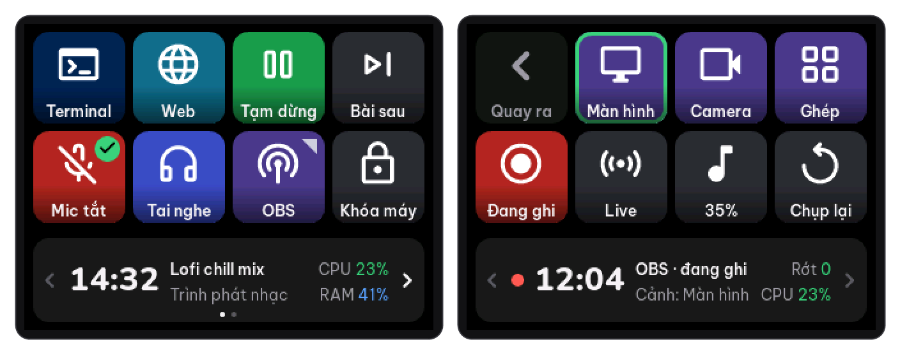
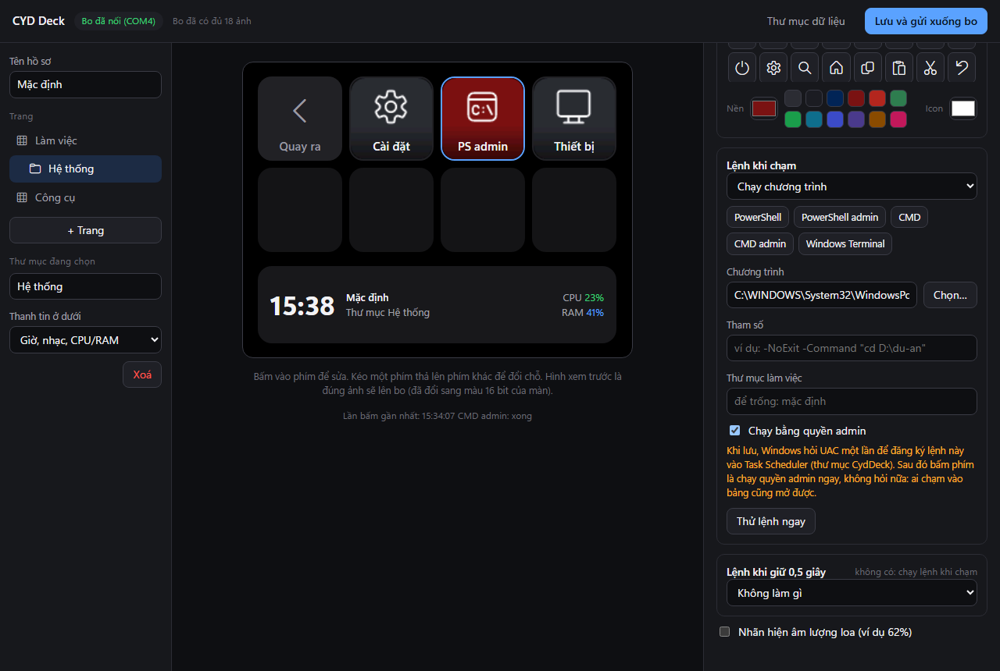
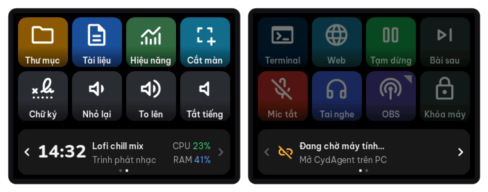

# Stream Deck for ESP32-CYD

**Tiếng Việt** · [English](#english)

Stream Deck gọn nhẹ cho Windows, chạy trên bo ESP32 "Cheap Yellow Display" (CYD) giá rẻ: 8 phím cảm ứng có ảnh màu,
thanh thông tin, thư mục, phím bật/tắt, chạy lệnh bằng quyền admin. Cấu hình phím bằng một trang web ngay trên máy.



*Ảnh chụp trực tiếp từ bộ nhớ màn hình của bo, phóng to 2 lần: trang chính và thư mục OBS.*

## Tiếng Việt

### Có gì

- **8 phím 72×72 px** có ảnh màu và nhãn. Bố cục giống Stream Deck Neo: lưới 4×2 cộng thanh tin ở dưới (giờ, CPU,
  RAM). Lật trang bằng hai mép thanh tin hoặc vuốt ngang.
- **Thư mục**: phím có góc tam giác mở một bộ 8 phím khác, phím ‹ để quay ra.
- **Phím bật/tắt** theo trạng thái thật của Windows: tắt mic, tắt tiếng loa. Phím âm lượng hiện số % ngay trên nhãn.
- **Lệnh**: chạy chương trình (kèm tham số, thư mục làm việc, quyền admin), mở web, file, thư mục hay `ms-settings:`,
  phím tắt (`Ctrl+Shift+Esc`, `Win+Shift+S`...), gõ một đoạn chữ, nhạc (phát/dừng, bài sau), âm lượng, mic, khoá máy.
  Mỗi phím có thêm một lệnh khi giữ 0,5 giây.
- **Quyền admin không hỏi UAC mỗi lần**: lúc lưu, Windows hỏi UAC **một** lần để đăng ký lệnh vào Task Scheduler; sau
  đó bấm phím là mở được PowerShell hay CMD quyền admin ngay.
- **Hiệu ứng mượt (~55–60 khung/giây)**:
  - gợn sóng lan từ chỗ ngón tay chạm, phím lún rồi nảy như lò xo;
  - viền trắng chờ PC, xanh khi xong, cam khi lỗi;
  - lật trang trượt bằng cuộn phần cứng của màn ILI9341.
- **Ảnh và bộ phím lưu trong flash của bo**, rút cáp vẫn còn. PC chỉ gửi những ảnh bo chưa có.
- **Chỉ cần cáp USB**: không Wi-Fi, không mở cổng tường lửa, không cài thêm runtime. Agent trên PC dịch bằng `csc.exe`
  có sẵn trong Windows.



*Trang cài đặt (mở từ icon ở khay hệ thống): lưới phím xem trước đúng màu sẽ lên bo, kéo thả để đổi chỗ phím, chọn
icon, màu, lệnh.*



### Cần gì

| | |
|---|---|
| Bo | ESP32-2432S028R ("Cheap Yellow Display", 2,8", 320×240, ILI9341, cảm ứng điện trở XPT2046). Đã thử với màn IPS mã `81 81 B3` (firmware tự đảo màu). Bản 2 cổng USB dùng màn ST7789: env `cyd2usb`, chưa thử. |
| Máy tính | Windows 10/11 có .NET Framework 4 (có sẵn). Nên dùng Windows 11: icon trong trang cài đặt lấy từ font Segoe Fluent Icons. Edge để mở cửa sổ cài đặt. |
| Nạp firmware | [PlatformIO](https://platformio.org/) (bản dòng lệnh hoặc extension VS Code) |

### Cài đặt

1. **Nạp firmware** (thư mục `firmware`):
   ```powershell
   cd firmware
   .\cyd.cmd all -NoMonitor
   ```
   Lệnh này build, nạp, rồi đọc mã chip màn để kiểm tra đúng loại. Cũng có thể dùng `pio run -t upload`.
   Chưa nối máy tính thì bo hiện bộ phím mẫu và báo "Đang chờ máy tính…".
2. **Dịch và chạy agent** (thư mục `pc-agent`):
   - nhấp đúp `build.cmd`, ra file `bin\CydAgent.exe`;
   - chạy `bin\CydAgent.exe`: agent không có cửa sổ, chỉ có icon nhỏ ở khay hệ thống;
   - muốn agent tự chạy mỗi lần đăng nhập Windows: chạy `tu-chay.ps1`.
3. **Cài đặt phím**: nhấp đúp icon agent ở khay, hoặc chuột phải → *Cài đặt Deck…*. Sửa phím, bấm **Lưu và gửi xuống
   bo**.

Agent tự tìm bo theo chip USB-serial (CH340, CP210x, ESP32-S3), mở cổng mà không khởi động lại bo. Bộ phím lưu ở
`%APPDATA%\CydDeck\deck.json`, ảnh tải lên ở `%APPDATA%\CydDeck\images\`.

### Quyền admin và an toàn

- Trang cài đặt chỉ nghe ở `127.0.0.1`. Mọi lệnh gửi tới nó cần một mã ngẫu nhiên tạo mỗi lần agent khởi động, nên
  trang web lạ trong trình duyệt không sửa được bộ phím.
- Phím "Chạy bằng quyền admin" được đăng ký thành tác vụ trong Task Scheduler (thư mục `\CydDeck\`). Tác vụ chạy bằng
  tài khoản của bạn ở quyền cao nhất, chỉ bạn, SYSTEM và Administrators chạy được.
  - Bấm *No* ở hộp UAC: phím vẫn chạy, nhưng Windows hỏi UAC mỗi lần.
  - **Lưu ý**: ai chạm vào bảng cũng mở được cửa sổ admin. Đừng đặt phím admin nếu bảng để ở chỗ người khác dùng được.
- Gỡ: xoá các phím admin rồi Lưu, hoặc xoá thư mục `CydDeck` trong Task Scheduler.

### Cấu trúc

```
firmware/    C++ / LVGL 9.5 / PlatformIO cho bo CYD
  src/cyd/     màn hình, cảm ứng, cuộn phần cứng
  src/app/     hiệu ứng (motion), bảng màu, icon
  src/deck/    giao diện bộ phím, giao thức USB (link), kho ảnh trong flash (store),
               bộ phím mẫu, chụp màn hình (shot), đo hiệu năng (perf)
  tools/       cyd.ps1 (build, nạp, chụp màn), sinh ảnh phím mẫu
pc-agent/    CydAgent: chương trình ở khay hệ thống, C# 5 / .NET Framework 4
  src/         Deck*.cs (bộ phím, giao thức, lệnh, máy chủ trang cài đặt), KeyArt.cs (vẽ ảnh phím)
  web/         trang cài đặt (một file HTML)
docs/images/ ảnh trong README
```

Giao thức giữa PC và bo ghi ở đầu `firmware/src/deck/link.h`.
- PC → bo: gói nhị phân có CRC.
- Bo → PC: dòng chữ `[DECK] ...`.

Ảnh phím là RGB565 72×72, mã ảnh là CRC-32 của điểm ảnh.

`.\cyd.cmd shot` chụp lại màn hình bo qua cổng Serial (các ảnh trong README được chụp như vậy).

### Chưa có

- Điều khiển OBS (đổi cảnh, ghi, live). Thư mục OBS trong ảnh là bộ phím mẫu.
- Tự đổi bộ phím theo app đang mở.
- Tên bài đang phát trên thanh tin.
- Giao diện mới có tiếng Việt.

### Giấy phép

Mã nguồn: [MIT](LICENSE). Thành phần của bên khác:
- [LVGL](https://github.com/lvgl/lvgl) (MIT), [TFT_eSPI](https://github.com/Bodmer/TFT_eSPI) (FreeBSD),
  [XPT2046_Touchscreen](https://github.com/PaulStoffregen/XPT2046_Touchscreen) (MIT): PlatformIO tự tải lúc build.
- Font [Be Vietnam Pro](https://github.com/bettergui/BeVietnamPro) và [Nunito](https://github.com/googlefonts/nunito)
  (SIL OFL 1.1); icon [Material Symbols](https://github.com/google/material-design-icons) (Apache 2.0). Giấy phép đi
  kèm trong `firmware/assets/fonts/`.

"Stream Deck" là nhãn hiệu của Corsair/Elgato. Dự án này không liên quan gì tới Elgato; tên chỉ để mô tả thiết bị nó
mô phỏng.

---

<a id="english"></a>

## English

A lightweight Stream Deck for Windows that runs on the cheap ESP32 "Cheap Yellow Display" (CYD) board: 8 touch keys
with colour images, an info bar, folders, toggle keys, and commands that can run as administrator. Keys are configured
in a local web page on your PC.

### Features

- **8 keys of 72×72 px** with colour artwork and titles. The layout follows the Stream Deck Neo: a 4×2 grid plus an
  info bar (clock, CPU, RAM). Change pages with the two ends of the info bar or by swiping.
- **Folders**: a key with a corner triangle opens another set of 8 keys; the ‹ key goes back.
- **Toggle keys** that follow the real Windows state: microphone mute, speaker mute. A volume key can show the current
  level as its title.
- **Actions**:
  - run a program, with arguments, working folder and an optional admin flag;
  - open a URL, file, folder or `ms-settings:` page;
  - send a hotkey (`Ctrl+Shift+Esc`, `Win+Shift+S`, …) or type a text snippet;
  - media control (play/pause, next), volume, microphone, lock the PC.

  Each key can also have a second action for a 0.5 s hold.
- **Admin without a UAC prompt on every press**: when you save, Windows asks once to register admin actions in Task
  Scheduler; after that the key opens an elevated PowerShell or CMD immediately.
- **Smooth animation (~55–60 fps)**:
  - a ripple spreads from the touch point, and the key presses in and springs back;
  - the border pulses white while the PC works, then turns green on success or orange on error;
  - pages slide using the ILI9341 hardware scroll.
- **Images and layout live in the board's flash**, so they survive unplugging. The PC only sends images the board does
  not have yet.
- **USB cable only**: no Wi-Fi, no firewall rules, no extra runtime. The PC agent is compiled with the `csc.exe` that
  ships with Windows.

The board screenshots above are read back from the display memory over serial, at 2× scale. The board UI and the
settings page are in Vietnamese for now.

### Requirements

| | |
|---|---|
| Board | ESP32-2432S028R ("Cheap Yellow Display", 2.8", 320×240, ILI9341, XPT2046 resistive touch). Tested on the IPS panel with ID `81 81 B3` (the firmware enables colour inversion automatically). The dual-USB version with an ST7789 panel builds with env `cyd2usb`, untested. |
| PC | Windows 10/11 with .NET Framework 4 (built in). Windows 11 is recommended because key icons in the settings page use the Segoe Fluent Icons font. Edge opens the settings window. |
| Flashing | [PlatformIO](https://platformio.org/) (CLI or the VS Code extension) |

### Getting started

1. **Flash the firmware** (`firmware` folder):
   ```powershell
   cd firmware
   .\cyd.cmd all -NoMonitor
   ```
   This builds, uploads, then reads the panel ID to check the display type. `pio run -t upload` works too. Until the
   PC agent connects, the board shows a sample layout and "waiting for computer".
2. **Build and run the agent** (`pc-agent` folder):
   - double-click `build.cmd` to get `bin\CydAgent.exe`;
   - run `bin\CydAgent.exe`: it has no window, only a small tray icon;
   - to start it at every Windows sign-in, run `tu-chay.ps1`.
3. **Configure keys**: double-click the tray icon, or right-click → *Cài đặt Deck…* (Deck settings). Edit the keys,
   then press **Lưu và gửi xuống bo** (Save and send to the board).

The agent finds the board by its USB-serial chip (CH340, CP210x, ESP32-S3) and opens the port without resetting the
board. The layout is stored in `%APPDATA%\CydDeck\deck.json`, uploaded images in `%APPDATA%\CydDeck\images\`.

### Admin actions and security

- The settings page listens on `127.0.0.1` only. Every API call needs a random token created when the agent starts,
  so a web page in your browser cannot change your keys.
- "Run as administrator" keys become tasks in Task Scheduler (folder `\CydDeck\`). They run under your account at the
  highest privilege, and only you, SYSTEM and Administrators may start them.
  - If you answer *No* to UAC, the key still works, but Windows asks every time.
  - **Note**: anyone who can touch the board can open an elevated window. Do not add admin keys if others can reach
    the board.
- To remove them, delete the admin keys and save, or delete the `CydDeck` folder in Task Scheduler.

### Project layout

```
firmware/    C++ / LVGL 9.5 / PlatformIO for the CYD board
  src/cyd/     display, touch, hardware scroll
  src/app/     animation (motion), palette, icons
  src/deck/    deck UI, USB protocol (link), image store in flash (store),
               sample layout, screenshots (shot), performance test (perf)
  tools/       cyd.ps1 (build, flash, screenshots), sample key image generator
pc-agent/    CydAgent tray app, C# 5 / .NET Framework 4
  src/         Deck*.cs (layout, protocol, actions, settings web server), KeyArt.cs (key artwork)
  web/         settings page (a single HTML file)
docs/images/ README images
```

The PC ↔ board protocol is documented at the top of `firmware/src/deck/link.h`.
- PC → board: binary frames with a CRC.
- Board → PC: `[DECK] ...` text lines.

Key images are 72×72 RGB565, identified by the CRC-32 of their pixels.

`.\cyd.cmd shot` captures the board's screens over serial; the README images were made that way.

### Not yet

- OBS control (scenes, record, stream). The OBS folder in the screenshots is the sample layout.
- Switching the layout automatically with the foreground app.
- Now-playing track title in the info bar.
- Languages other than Vietnamese in the UI.

### License

Code: [MIT](LICENSE). Third-party parts:
- [LVGL](https://github.com/lvgl/lvgl) (MIT), [TFT_eSPI](https://github.com/Bodmer/TFT_eSPI) (FreeBSD) and
  [XPT2046_Touchscreen](https://github.com/PaulStoffregen/XPT2046_Touchscreen) (MIT), downloaded by PlatformIO at build
  time.
- Fonts [Be Vietnam Pro](https://github.com/bettergui/BeVietnamPro) and [Nunito](https://github.com/googlefonts/nunito)
  (SIL OFL 1.1) and [Material Symbols](https://github.com/google/material-design-icons) icons (Apache 2.0). Their
  licenses are in `firmware/assets/fonts/`.

"Stream Deck" is a trademark of Corsair/Elgato. This project is not affiliated with Elgato; the name only describes
the kind of device it imitates.
